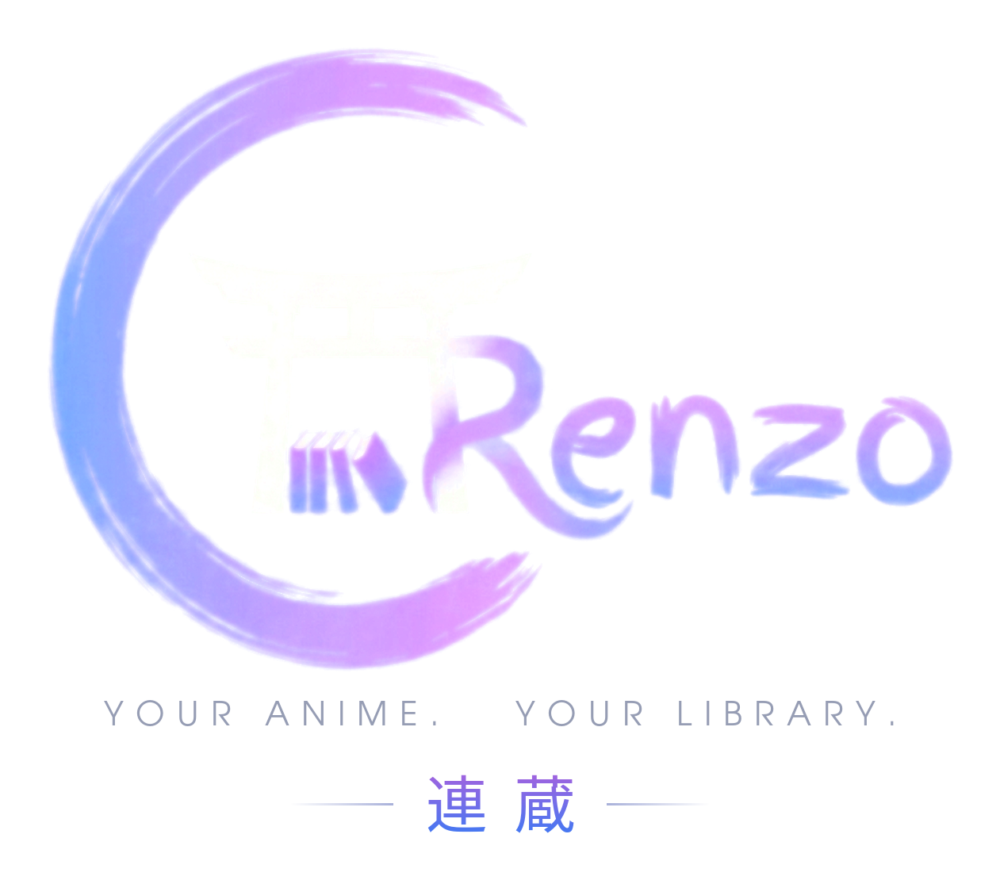

<p align="center">
  
</p>

<h1 align="center">Renzo</h1>

<p align="center"><b>Self-hosted anime streaming and downloads through your own debrid account.</b></p>

Renzo is a one-service "arr" for anime with its own web UI. Search the
catalogue, press play, and Renzo finds a release, prepares it on your
Real-Debrid or AllDebrid account and streams it straight away. It can also
download episodes into a per-user library, keep subtitles next to them, sync
what you watch to AniList / MyAnimeList / Kitsu, and pick up new episodes on a
schedule.

No Sonarr, Radarr, rclone or mounts: one Node.js process, one container.

**Documentation: [the Renzo wiki](https://github.com/Levitate0/Renzo/wiki).**

## Features

- **Discover and search** anime series and movies with AniList metadata and art
  (MyAnimeList fallback for the browse rows).
- **Instant streaming** via Real-Debrid or AllDebrid. Releases are found on
  AnimeTosho and Nyaa and ranked by episode, resolution, seeders and your
  preferred release group. Torrent traffic never touches your own IP.
- **Background downloads** into a Jellyfin-friendly library, with season grabs,
  your own folders, and a queue with "download now" and retry.
- **Auto-download** of new episodes for series you flag, and of your AniList
  Watching list, on a schedule.
- **Subtitles**: English tracks extracted from the release, Japanese from
  Jimaku, served as WebVTT and saved next to downloads.
- **Built-in player** with resume on any device, autoplay with an "Up next"
  countdown, seek-bar previews and episode air dates.
- **Franchise grouping**: every season, movie and OVA of a series shown and
  managed as one, with correct season numbering.
- **Multi-user** with owner / manager / user roles, invites, per-user debrid
  keys and fully isolated libraries; household members can stream each other's
  downloaded copies.
- **Tracker sync** with AniList, MyAnimeList and Kitsu: import, scrobble, status
  and score.
- **TV pairing** by code, per-device session management, browser offline viewing,
  optional Jellyfin rescan and a Jellyfin channel plugin.

Renzo is part of an ecosystem with **Renzo Shiori** (manga server) and
**[Renzo Hub](https://github.com/Levitate0/Renzo-Hub)**, the native client for
Android, Android TV and Windows. Renzo Hub is the only native client; it uses
the same API as the web UI.

## Quick start (Docker)

```yaml
# docker-compose.yml
services:
  renzo:
    image: ghcr.io/levitate0/renzo:1.5.0   # pin a version; :latest moves on every release
    container_name: renzo
    restart: unless-stopped
    ports:
      - "8787:8787"
    environment:
      DATA_DIR: /data
      LIBRARY_DIR: /library
      PUBLIC_URL: "https://renzo.example.com"   # the URL people use to reach Renzo
      # TRUST_PROXY: "loopback"                 # address of your reverse proxy, see the wiki
      AUTO_DOWNLOAD: "true"
      # JIMAKU_API_KEY: "<optional-shared-jimaku-key>"
      # JELLYFIN_URL: "http://jellyfin.example.lan:8096"
      # JELLYFIN_API_KEY: "<jellyfin-api-key>"
    volumes:
      - ./data:/data          # database + caches: back this up
      - ./library:/library    # downloaded video + subtitles
```

```bash
docker compose up -d
```

Open `http://<host>:8787`, create the owner account on the setup screen, then
add your Real-Debrid token or AllDebrid key under **Account > Credentials**.
Every user brings their own debrid account; a premium subscription is needed to
stream or download.

The image is published for `linux/amd64` and `linux/arm64`. For public access
put Renzo behind a TLS reverse proxy and set `PUBLIC_URL` and `TRUST_PROXY`.

## Documentation

| Page | Contents |
|---|---|
| [Installation](https://github.com/Levitate0/Renzo/wiki/Installation) | Docker setup, first run, reverse proxy, Jellyfin |
| [Configuration](https://github.com/Levitate0/Renzo/wiki/Configuration) | Every environment variable and setting |
| [Features](https://github.com/Levitate0/Renzo/wiki/Features) | User guide |
| [Architecture](https://github.com/Levitate0/Renzo/wiki/Architecture) | How search, debrid, downloads, streaming, subtitles and season grouping work |
| [API Reference](https://github.com/Levitate0/Renzo/wiki/API-Reference) | Every HTTP route |
| [Development](https://github.com/Levitate0/Renzo/wiki/Development) | Build and run from source |
| [Releasing](https://github.com/Levitate0/Renzo/wiki/Releasing) | Tags, CI image publishing, release notes |
| [Troubleshooting](https://github.com/Levitate0/Renzo/wiki/Troubleshooting) | Common failures and fixes |

## Build from source

```bash
npm ci
(cd frontend && npm ci && npm run build)
cp .env.example .env
npm run build && npm start
```

Requires Node.js 20+, and `ffmpeg` on `PATH` for subtitle extraction. See
[Development](https://github.com/Levitate0/Renzo/wiki/Development).
